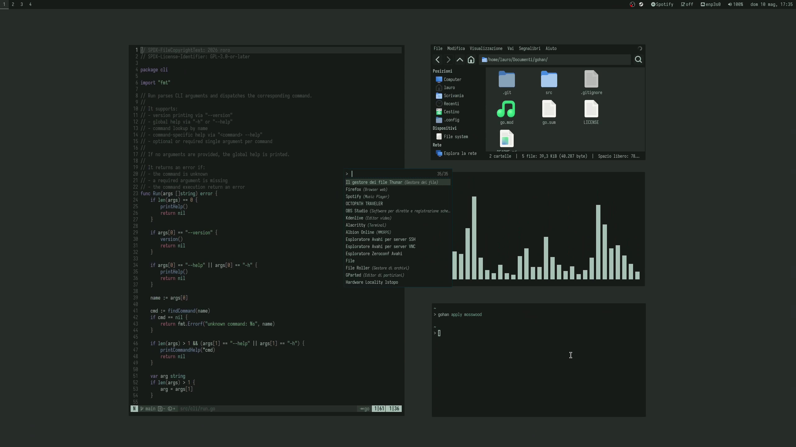

# gohan
A CLI tool to handle base16-powered Linux ricing.

## Why?
Managing colors across multiple config files can quickly become messy.  
**gohan** simplifies this by letting you define colors inline.

## Overview
**gohan** is a simple command line tool to help you apply base16 color palettes across your Linux setup.  
The goal is to simplify templating by reducing the number of files required.

Themes are applied via inline template processing: you just wrap your colors between two markers and gohan takes care of the rest.

For example:

```
@gohan:start
background: #1d2021
foreground: #d5c4a1
@gohan:end

bla bla bla

@gohan:start
red: #fb4934
green: #b8bb26
blue: #83a598
@gohan:end

```

gohan identifies blocks marked by `@gohan:start` and `@gohan:end`, maps the existing colors to their base16 equvalents, and replaces them using the selected palette.

## Demo
[](./assets/gohan_demo.webm)

## Installation

Make sure you have Git and Go installed.

Assuming `~/.local/bin` is in your PATH:

```
git clone https://codeberg.org/roro/gohan
cd gohan
go build -o gohan ./src/main
mv ./gohan ~/.local/bin/
```
Then open a new terminal and check:
```
gohan --help
```

or

```
gohan --version
```


## Configuration
gohan reads its configuration and palettes from:

```
$XDG_CONFIG_HOME/gohan
```

(default: `~/.config/gohan`)

Example structure:

```
~/.config/gohan/
├── config.yaml
└── palettes/
    ├── nord.yaml
    ├── gruvbox-dark-hard.yaml
    └── dracula.yaml
```

### Config file
`config.yaml` must contain:
-   a list of `targets` (files to process)
-   optionally, a list of `commands` (executed after processing)
    

Example:
```
targets:
  - ~/.config/alacritty/alacritty.yml
  - ~/.themes/colors.css

commands:
  - pkill -USR1 alacritty
  - notify-send "Theme applied"
```


### Palettes
The `palettes/` directory contains your palette files.

gohan supports palettes formatted according to the base16 standard, but is more permissive.  
It only requires:

-   16 base keys (`base00` to `base0F`)
-   valid hex colors (with or without `#`, with or without quotes)

Example:
```
base00: "000000"
base01: "111111"
base02: "222222"
base03: "333333"
base04: "444444"
base05: "555555"
base06: "666666"
base07: "777777"
base08: "888888"
base09: "999999"
base0A: "aaaaaa"
base0B: "bbbbbb"
base0C: "cccccc"
base0D: "dddddd"
base0E: "eeeeee"
base0F: "ffffff"
```

or:

```
base00: "#000000"
base01: "#111111"
base02: "#222222"
base03: "#333333"
base04: "#444444"
base05: "#555555"
base06: "#666666"
base07: "#777777"
base08: "#888888"
base09: "#999999"
base0A: "#aaaaaa"
base0B: "#bbbbbb"
base0C: "#cccccc"
base0D: "#dddddd"
base0E: "#eeeeee"
base0F: "#ffffff"
```

The filename becomes the palette name.

### Target files
gohan processes blocks between markers. A block looks like:

```
@gohan:start
Ferrari's red is #FF2800
@gohan:end
```
(P.S.: Don't process this block! Ferrari's red is already perfect!)

Markers can appear anywhere on a line, so you can easily embed them in comments:

```
// @gohan:start
focus-ring {
    width 1
    active-color "#a9b7c2"
    inactive-color "#262b33"
}
// @gohan:end

```

### Current palette file
gohan stores the current palette at:
```
$XDG_STATE_HOME/gohan/current.yaml
```
(default: `~/.local/state/gohan/current.yaml`)
This file is used to map colors to base keys when applying a new palette.

## Initial setup
This is the most tedious step:
1.  Add the palette you originally used to your `palettes/` directory
2.  Ensure it is valid
3.  Add markers to all target files
4.  Create your config file
    
Then initialize gohan:

```
gohan init <palette_name>
```


## Usage
### Show help
```
gohan --help
```

### Show version
```
gohan --version
```

### List available palettes
This command prints the file names of the palettes defined in the `palettes` folder. gohan assumes these are the palette names.
```
gohan list
```

### Initalize state
This creates gohan's current palette file. Necessary when using gohan for the first time.
```
gohan init <palette_name>

e.g.:

gohan init nord
```

### Apply a palette
This will apply a palette to every target written in the config file, update the current palette file and execute the commands written in the config file.
```
gohan apply <palette_name>

e.g.:

gohan apply nord
```

## Credits
gohan uses `gopkg.in/yaml.v3` (Apache-2.0, MIT) for YAML parsing.


## Support
If you like this project or find it useful, please consider donating to these organizations and join me in supporting them:

- 👶 [UNICEF](https://www.unicef.org/)
- 🐼 [WWF](https://www.worldwildlife.org/)

If you'd prefer to support me directly, you can do so here:
- ☕ [Ko-fi](https://ko-fi.com/roro0)

Thank you!

## License
Licensed under the GNU GPL-3.0-or-later.
